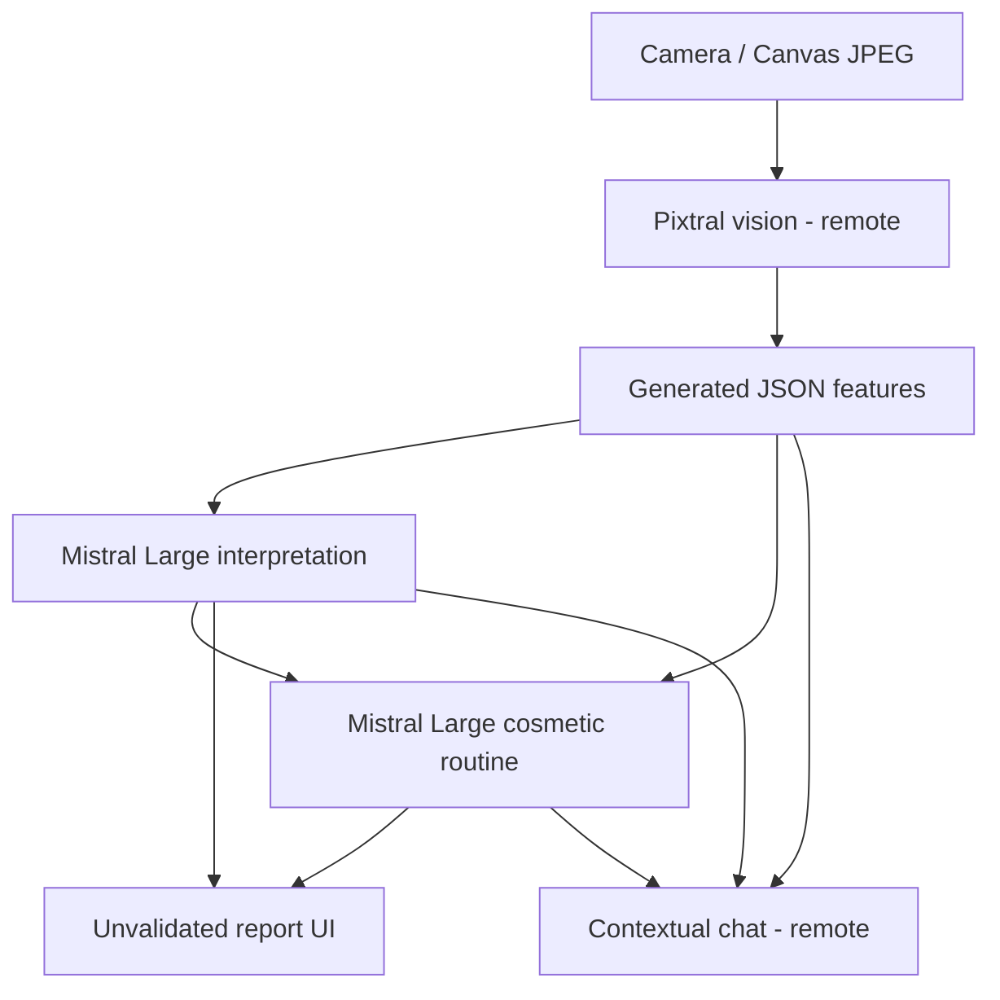

# PureScan AI V6 — Studio Niko Design

**Experimental sequential vision-to-text orchestration for skin-image exploration — not a dermatology tool.**

Un prototype d'orchestration multimodale qui sépare acquisition d'image, interprétation générative et génération cosmétique. La chaîne illustre la composition de requêtes IA, mais ne mesure pas des paramètres biologiques et ne constitue pas une consultation médicale.

    

**STUDIO NIKO DESIGN** · Build smart. Stay lightweight. Create without limits.

[English overview](#english-overview) · [Quickstart](#quickstart--démarrage-rapide) · [Portfolio](https://github.com/Nikoju1977)

> Démonstration : images synthétiques uniquement. Aucun GIF ni résultat de test n'est revendiqué.

> **Prototype non validé cliniquement.** Ne pas utiliser pour un diagnostic, une prescription, un triage, une décision de traitement ou une urgence. En France, danger immédiat : 15 ou 112. Inspection statique uniquement ; aucun nouveau test d'exécution, audit de sécurité, test fournisseur, benchmark, validation clinique ou vérification de déploiement n'a été effectué.

## Fonctionnalités clés

- Acquisition caméra, sélection de caméra, attente de disponibilité et capture JPEG limitée à 640 pixels sur le plus grand côté.
- Trois étapes réseau : Pixtral vision, Mistral Large interprétation, Mistral Large routine cosmétique facultative en cas d'échec.
- Sections rapport, nettoyage, produits, routine, traitement et chat ; leur présence ne valide pas les recommandations.
- Chat contextuel utilisant les résultats précédents et un historique borné.

## Architecture & algorithmes

| Fonction | Constat |
| --- | --- |
| `captureFrame` | Redimensionnement Canvas et encodage JPEG ; aucune mesure calibrée ni segmentation clinique. |
| `callPixtral` | Requête `pixtral-12b-2409` avec photographie ; les valeurs structurées sont générées par le modèle, non mesurées par un capteur biologique. |
| `callDerm` / `callClean` | Deux appels `mistral-large-latest` successifs utilisant les résultats précédents ; la troisième étape peut échouer sans interrompre le rapport principal. |
| `safeJsonParse` | Parsing syntaxique du JSON, pas une validation complète du schéma, des unités, de la plausibilité ou de la vérité des résultats. |

**Risques cliniques majeurs :** les scores de bactéries, champignons, sébum, hydratation et pathologies ne sont pas des mesures validées à partir d'une photo ordinaire. Les erreurs d'un modèle peuvent être propagées aux étapes suivantes ; il ne s'agit pas d'un consensus indépendant. Les prompts sollicitent diagnostic et traitement sous un rôle de dermatologue, alors que le prototype ne possède aucune validation clinique. Les classifications « clean beauty » ne démontrent ni toxicité ni innocuité. Ne pas suivre de traitements ou exclure une maladie à partir du rapport. Le projet n'est pas un scanner d'ingrédients alimentaires.

## Confidentialité et sécurité

- La capture JPEG est envoyée à Mistral ; les résultats sont ensuite transmis aux étapes textuelles et au chat, avec les questions de l'utilisateur. Aucune anonymisation clinique garantie et aucune preuve de politique de conservation fournisseur.
- Dans le parcours inspecté, la clé API du chat reste en mémoire de session (`chatApiKey`). La façade `safeStorage` utilisée ailleurs repose sur localStorage/repli mémoire, pas sur le chiffrement annoncé dans un commentaire. Aucun coffre patient chiffré n'est établi.
- Des rapports construits dynamiquement utilisent `innerHTML` et des échappements partiels. Un audit du rendu, une validation de schéma stricte et une politique de contenu sont nécessaires ; le parsing JSON n'est pas une barrière XSS.
- Google Fonts et API Mistral nécessitent Internet ; le service worker tente un enregistrement Blob, dont le fonctionnement n'est pas établi. L'accès caméra demande une permission. Ne pas utiliser de données médicales réelles, de visages privés ou de clés réelles dans la démonstration.

## Référentiels et limites

DICOM (pour l'imagerie concernée), ISO 13485 (qualité), IEC 62304 (cycle de vie logiciel), ISO 14971 (risques), RGPD (données personnelles) et FDA 21 CFR Part 11 (enregistrements électroniques réglementés) sont des pistes de qualification selon l'usage prévu et le cadre applicable. Aucun certificat, marquage CE, autorisation réglementaire, audit indépendant ou conformité à ces référentiels n'est revendiqué. Les licences logicielles ne constituent pas une autorisation d'usage clinique. Une revue par des professionnels qualifiés est indispensable avant tout usage médical.

## Quickstart / Démarrage rapide

Servir `index.html` depuis localhost avec `python3 -m http.server 8000`. Examiner le parcours sans clé réelle et sans photographie personnelle. Les appels distants exigent un compte autorisé et peuvent être facturés ; aucun compte ni résultat réel n'est testé ici.

## Qualification proposée — intégrité du pipeline visuel

**Usage expérimental uniquement :** exploration de la chaîne image-vers-texte sur images synthétiques. Neutraliser les conclusions diagnostiques et recommandations thérapeutiques avant toute démonstration destinée à des utilisateurs non spécialistes.

| Contrôle proposé (non exécuté) | Critère attendu |
| --- | --- |
| Acquisition | Vérifier les dimensions de la capture et les permissions sur une scène fictive |
| Réponse structurée | Rejeter JSON invalide, champs absents, types incompatibles et valeurs hors domaine |
| Propagation | Interrompre les interprétations en aval si la première étape est invalide |
| Erreur fournisseur | Afficher une indisponibilité, sans inventer de résultat ni assimiler une réponse partielle à une analyse complète |
| Rendu et confidentialité | Vérifier le traitement des contenus non fiables, le consentement et les transferts de données sur réponses simulées |
| Sécurité clinique | Ne présenter aucun score biologique généré comme une mesure, ni une routine comme prescription |

Les trois appels successifs ne produisent pas une validation indépendante. Un JSON syntaxiquement valide ne garantit ni une mesure réelle ni une interprétation correcte. Les tests proposés ne sont pas des preuves d'efficacité clinique. Aucun appel au fournisseur n'a été réalisé pour cette révision.

**English:** Proposed synthetic checks cover acquisition, schema validation, error propagation, safe rendering and privacy. Disable unvalidated diagnostic and treatment outputs. No new tests, provider calls or clinical validation were performed.

## Roadmap & contribution

Propositions non terminées :

- [ ] Neutraliser les diagnostics, traitements et scores biologiques non mesurés ; privilégier une description visuelle non médicale.
- [ ] Valider strictement les réponses structurées, rendre les erreurs explicites et auditer le DOM.
- [ ] Documenter et qualifier le consentement, la minimisation des images et les flux vers chaque étape et le chat.
- [ ] Tester les échecs réseau, les permissions et la propagation d'erreurs avec réponses simulées et images synthétiques.

**Première contribution / `good first issue` (label proposé, non créé ici) :** Proposer un test de réponse JSON invalide ou de score absent qui bloque la présentation d'une conclusion.

Les retours sont bienvenus dans le cadre des droits existants. [Issues](https://github.com/Nikoju1977/purescanai/issues) pour les anomalies non sensibles. Ne jamais publier de données médicales, images identifiantes, secrets ou détails exploitables de vulnérabilité ; contacter le mainteneur en privé pour les signalements sensibles.

## English overview

PureScan AI V6 uses three sequential remote calls: Pixtral vision, Mistral Large interpretation and Mistral Large cosmetic routine, plus contextual chat. Outputs are generated, not calibrated biological measurements; errors can propagate across stages. Do not use its diagnoses, treatments or scores for medical decisions. Images, generated patient-related context and chat messages may be sent to the provider. JSON parsing is not clinical or security validation. Use synthetic data only.

No new runtime, provider, security or clinical validation was performed for this documentation revision.

## Licence & auteur / License & author

[Notice de droits](LICENSE.md) © 2026 Studio Niko Design (Nikoju1977). Tous droits réservés pour les contributions originales concernées ; publication publique ne vaut pas licence open source. Les composants tiers gardent leurs droits. Aucun fichier de licence n'a été modifié.

[Studio Niko Design](https://github.com/Nikoju1977)
